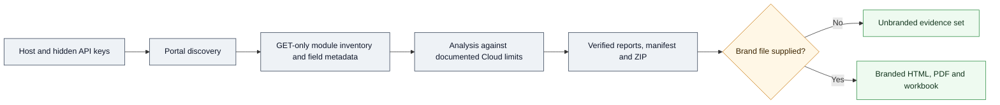
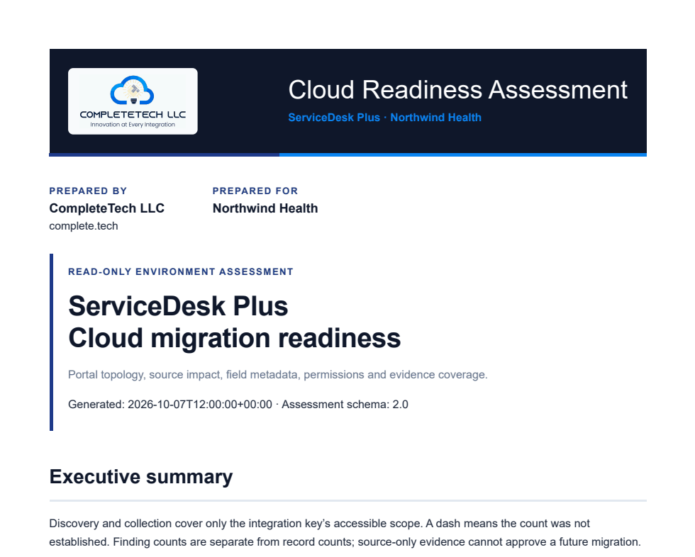

**CompleteTech LLC Skills** · [Start here](ONBOARDING.md) · [Agent instructions](SKILL.md) · [Branding](BRANDING.md) · [Skill library](https://github.com/CompleteTech-LLC/agentic-services-orchestrator-skill/blob/main/references/skill-family.md) · [Documentation](docs/README.md) · [Contributing](CONTRIBUTING.md)

# ServiceDesk Plus Cloud Readiness

<p align="center">
  
</p>

A local, read-only assessment of ManageEngine ServiceDesk Plus on-premises before migration to ServiceDesk Plus Cloud. It discovers every accessible portal, collects inventory and metadata through reviewed GET requests, measures the evidence against documented Cloud migration limits, and produces offline reports that separate confirmed impact from what remains unknown. The same run also produces CompleteTech-branded client deliverables.

**Python 3.10+ · standard library only · version 2.2.0 · MIT License**

A CompleteTech LLC skill. This is an independent assessment tool, not a ManageEngine product or migration utility.

## About

Migration planning needs evidence, not assumptions. The scanner reads the source installation the way an administrator would, within the visibility of the integration keys provided, and records exactly what it could and could not establish. Every finding carries its evidence basis, affected and examined counts, coverage, and a recommended action; every gap is reported rather than hidden. The output answers three questions for each portal: what will be affected, what could not be assessed and why, and what still needs a vendor or owner decision.

Part of the CompleteTech LLC skill library. The repository is also an agent skill. [SKILL.md](SKILL.md) instructs an agent to run the demonstration, hand the operator the live command, brand deliverables and summarize the outcome.

## Skill Metadata

| Item | Value |
|---|---|
| Skill key | `sdp-cloud-readiness` |
| Version | `2.2.0` |
| Runtime | `python3` (3.10 or newer), standard library only |
| Optional | `openpyxl` for the branded workbook; Microsoft Edge or Google Chrome for branded PDFs |
| Network | Only the ServiceDesk Plus host the operator names; GET requests through one global rate limiter |
| Homepage | https://github.com/CompleteTech-ManageEngine/sdp-cloud-readiness |
| License | Code, templates and documentation: MIT. Brand assets are reserved; see `BRAND_ASSETS.md` |
| Install | Place the whole folder in the agent's skills directory as `sdp-cloud-readiness` (for Claude Code, `~/.claude/skills/sdp-cloud-readiness`) |

## Workflow Diagram

Source: [assets/diagrams/workflow.mmd](assets/diagrams/workflow.mmd).



## What It Does

| Capability | Details |
|---|---|
| Portal discovery | Enumerates every visible ESM portal, or accepts an administrator-verified portal list when directory access is unavailable. No portal ID is guessed. |
| Inventory and metadata | Requests, problems, changes, projects, releases, assets, computers, CIs and CI types, contracts, purchases, incident and service templates, sites, support groups, technicians, users, organization users, reports and field definitions, with paginated lists, sampled details and module-aware custom-field discovery. |
| Migration analysis | Applies documented Cloud limits (history windows, attachment sizes, field lengths, option normalization, template complexity, duplicate identities and more) and classifies each finding as Confirmed impact, No issue observed, Unknown or Manual confirmation. |
| Coverage accounting | Records per portal and module whether lists completed, which details were sampled, and the HTTP/SDP evidence behind every gap, with specific recovery guidance. |
| Credentials | One key across portals, separate keys per instance (`--multi-key`, `--credential-file`, numbered `.env` slots), and separate directory and global credentials. Keys are never printed, saved or written to reports. |
| Long assessments | Budgets on requests and time; `--checkpoint` saves sanitized progress at instance boundaries and `--resume` continues or retries selected instances. |
| Reports | Offline HTML, Markdown, JSON and CSV, a vendor-questions document, sanitized diagnostics, a hash manifest and a verified ZIP. |
| Branded deliverables | CompleteTech-branded report and vendor questions (HTML and PDF) and a findings and coverage Excel workbook on every run; an approved engagement brand or `--brand none` on request. |

## Quick Start

From the repository root (or an extracted release):

```powershell
# Offline demonstration: synthetic portals, no credentials or network
python .\sdp_cloud_readiness.py --demo

# Live assessment of every accessible portal with CompleteTech deliverables
# (prompts for the host and a hidden API key)
python .\sdp_cloud_readiness.py --all-portals --prepared-for "Client Name"

# Another approved brand, or unbranded evidence only
python .\sdp_cloud_readiness.py --all-portals --brand C:\path\to\branding.json --prepared-for "Client Name"
python .\sdp_cloud_readiness.py --all-portals --brand none
```

On Windows, `Run-All-Portals.cmd` and `Run-Assessment.cmd` start the same assessment. Reports go to a new timestamped folder under `sdp-assessments/`.

For repeated runs, fill the local `.env` beside the entry point. A first normal run creates a blank scaffold without replacing an existing file; [.env.example](.env.example) shows `SDP_HOST`, optional directory and global keys, 20 numbered key/portal-ID pairs, and the optional `SDP_BRAND_FILE` and `SDP_PREPARED_FOR`. Process variables take precedence; use `--env-file <path>` or `--no-env` to override loading. See [local environment setup](docs/guides/local-env.md) and, for 14.x/15.x ESM, [where to create integration keys and choose roles](docs/guides/multiple-credentials.md#creating-keys-on-14x15x-esm).

| Task | Command |
|---|---|
| Restrict to explicit portals | `--portal-ids 1,3` |
| Separate key per instance | `--multi-key` or `--credential-file credentials.json` |
| Save resume points / continue | `--checkpoint`, then `--resume <checkpoint.json>` |
| Retry gaps after access changes | `--resume <checkpoint.json> --retry-failed` or `--retry-portals 3,5` |
| Brand an existing assessment, offline | `--prepared-for "Client" --brand-assessment <folder>` |
| Diagnose directory discovery only | `--diagnose` |
| Check local report output | `--check-output` |
| All options | `--help` |

## Outputs

| File | Purpose |
|---|---|
| `report.html` | Standalone offline report: outcomes, scope notes, coverage, findings with actions, vendor questions, sources |
| `report.md` | The same content in Markdown |
| `assessment.json` | Sanitized structured assessment |
| `findings.csv`, `coverage.csv` | Every finding and every coverage row for filtering and evidence |
| `vendor-questions.md` | Answers and open questions for ManageEngine, owners and the project |
| `diagnostics.json` | Sanitized discovery and request diagnostics |
| `report-manifest.json` and the folder ZIP | SHA-256 manifest and a read-back-verified archive |
| `branded/` | CompleteTech-branded copies (unless `--brand none`): `<Client>-Cloud-Readiness-Assessment.html/.pdf`, `<Client>-Vendor-Questions.html/.pdf`, `<Client>-Assessment-Findings-and-Coverage.xlsx`, `branded-manifest.json` |

Exit code `0` means the reports were written and verified, not that migration is safe; `2` means the assessment is incomplete or was stopped; `1` is a startup or local output error.

## Example



CompleteTech-branded report rendered from the synthetic demonstration for a fictional client. Unbranded examples: the [synthetic assessment](examples/synthetic-assessment/report.md) and the [recovery assessment](examples/recovery-assessment/report.md). Regenerate with `python .\sdp_cloud_readiness.py --demo --prepared-for "Northwind Health"`.

## Branding

Deliverables carry the CompleteTech LLC identity from the `completetech` preset ([templates/branding.completetech.json](templates/branding.completetech.json) and `assets/logo.png`): navy band, blue stripe, logo, prepared by/for block and footer. An approved engagement brand can be passed with `--brand`, and `--brand none` keeps only the unbranded evidence. Branded copies are rendered from the run's own evidence files and never modify the verified unbranded set. Layouts, tokens and logo rules are in [BRANDING.md](BRANDING.md).

## Contents

| Path | Purpose |
|---|---|
| `sdp_audit/` | Runtime package: transport, collection, analysis, reporting and branded copies |
| `SKILL.md`, `agents/` | Agent skill instructions and metadata |
| `BRANDING.md`, `BRAND_ASSETS.md` | Identity, palette, brand file format and asset rights |
| `ONBOARDING.md` | First-use walkthrough |
| `templates/`, `assets/logo.png` | CompleteTech branding preset and logo |
| `tests/` | Unit and integration tests with synthetic fixtures |
| `docs/guides/` | User instructions and troubleshooting |
| `docs/reference/` | API research, field discovery and diagnostic contracts |
| `docs/development/`, `docs/releases/` | Validation evidence and version notes |
| `examples/config/` | Non-secret configuration templates, including a fictional brand file |
| `examples/*-assessment/` | Committed synthetic report examples |
| `assets/diagrams/` | Workflow diagram source |
| `tools/` | Release tooling |
| `dist/` | Generated portable app, release ZIP and checksums; ignored by Git |

Further reading: [full usage guide](docs/guides/usage.md), [assess all portals](docs/guides/all-portals.md), [multiple credentials](docs/guides/multiple-credentials.md), [resume](docs/guides/resume.md), [coverage recovery](docs/guides/coverage-recovery.md), [troubleshooting](docs/guides/troubleshooting.md), [Windows key input](docs/guides/windows-key-input.md) and the [documentation index](docs/README.md).

## Portable Release

```powershell
python .\tools\build_release.py
python .\dist\sdp_cloud_readiness.pyz --version
```

The build writes the portable app, source ZIP, Windows launchers, example HTML and checksums to `dist/`. Extract the ZIP for a complete runnable distribution; its launchers prefer the adjacent portable app.

## Runtime Permissions

| Area | Runtime behavior |
|---|---|
| Execution | Local Python entry point or portable `.pyz`; optional headless Edge/Chrome to print branded PDFs. |
| Reads | The named ServiceDesk Plus host through allowlisted GET endpoints; local `.env`, configuration, portal, credential-reference and brand files the operator supplies. |
| Writes | A new assessment folder and ZIP under the chosen output directory; optional host-bound portal scope in the user profile only with `--save-portals`. |
| Network | Only the ServiceDesk Plus host. Reports load nothing external; the PDF browser runs with networking disabled. |

| Not Included | Boundary |
|---|---|
| Source changes | Never creates, updates or deletes records; no POST, PUT or DELETE. |
| Content | Raw ticket descriptions, notes, attachment bodies and unnecessary personal fields are excluded from reports. |
| Credentials | Keys are accepted only through the hidden prompt or environment; never as arguments, in reports or in diagnostics. |
| Approval | An assessment is not migration approval or proof of complete source visibility. |

Reports still contain internal structure, identifiers, counts and configuration findings; review them before sharing.

## License

Code, templates, and documentation are licensed under the [MIT License](LICENSE). CompleteTech LLC names, logos, seals, and brand assets are reserved and are not licensed for reuse except to identify this project. See [BRAND_ASSETS.md](BRAND_ASSETS.md).
